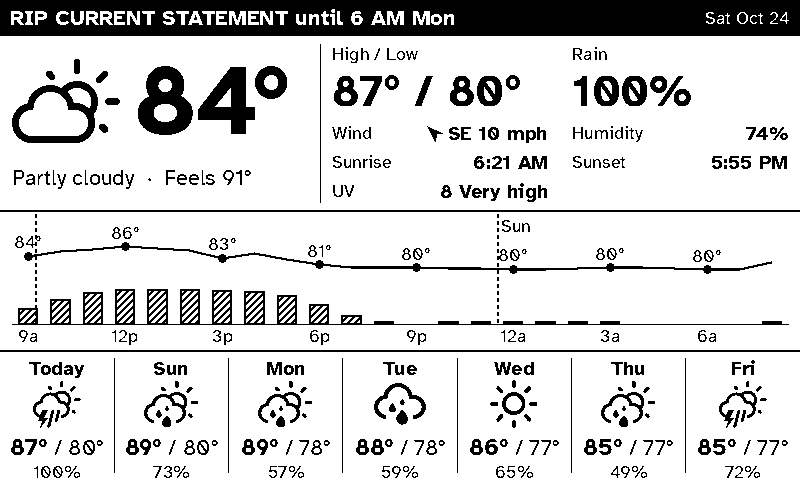

# inkypi-weather-bw

An [InkyPi](https://github.com/fatihak/InkyPi) plugin that draws a crisp, high-contrast weather board in pure black and white, built for 1-bit e-ink panels like the Waveshare 7.5" (800×480).



InkyPi's built-in Weather plugin renders a color web page, which a black-and-white panel turns into gray dot patterns that are hard to read across a room. This plugin draws every pixel as pure black or pure white: no gray, no dithering. Where shading is needed it uses hatching, outlines or solid black.

- **Three layouts:**
  - **Dashboard:** now, today's details, the next 24 hours and a 7-day row.
  - **Hourly:** a full-screen chart with an icon row.
  - **Week:** large day cards.
- **Orientation:** landscape and portrait.
- **Readable at a distance:** the current temperature, high/low and today's rain chance are at least 40 px. Nothing on the board is smaller than 18 px.
- **Alerts:** a solid black banner across the top while the National Weather Service has an active alert for your location (US only).
- **Survives Wi-Fi drops:** requests are retried with backoff. If they still fail, the board draws the last good data with an "Updated 7:15 AM (2 h ago)" stamp instead of going blank.
- **Icons:** [Weather Icons](https://erikflowers.github.io/weather-icons/), mapped from the forecast's weather codes, with day and night variants.

**Status:** actively maintained.

## Data sources

| Service | Used for | Key | Limits |
|---|---|---|---|
| [Open-Meteo](https://open-meteo.com/en/docs) `/v1/forecast` | current conditions, 24 h hourly, 7-day daily | none | Free for non-commercial use; fair-use limits far above one request per refresh |
| [National Weather Service](https://www.weather.gov/documentation/services-web-api) `/alerts/active` | the alert banner | none (a User-Agent header is sent) | US locations only; elsewhere the banner simply never appears |

One forecast request and one alerts request per refresh. If the board was refreshed less than 10 minutes ago, the cached data is reused and no request is made.

## Install

On the Pi, with InkyPi already installed:

```bash
inkypi plugin install weather_bw https://github.com/User10796/inkypi-weather-bw
```

This copies the `weather_bw/` folder into InkyPi's `src/plugins/` and restarts InkyPi. Run the same command again to update. The repo must stay public for the Pi to download it without credentials.

## Set up

1. On your phone, open `http://<hostname>.local` (for example `http://weather.local`) and tap **Weather (B&W)**.
2. Enter your **latitude** and **longitude**. In Apple Maps, drop a pin and swipe up to see them. Add a **location name** for the header, e.g. "Tifton".
3. Choose a layout, then press **Update Now** to preview it.
4. **Add to Playlist**. Suggested settings:
   - **Refresh:** every 15–20 minutes. InkyPi skips redrawing the panel when the image hasn't changed.
   - **Playlist window:** 06:00–22:00. The window acts as quiet hours, so there are no refreshes overnight.

To replace the built-in Weather plugin, remove it from the playlist and add this one instead. Both can stay installed.

## Settings

| Field | Default | Options |
|---|---|---|
| Latitude, Longitude | — | Required |
| Location name | — | Shown in the header |
| Layout | Dashboard | Dashboard, Hourly chart, Week cards |
| Units | °F, mph | °F and mph, or °C and km/h |
| Hours in chart | 24 | 12 or 24 |
| Days | 7 | 5 or 7 |
| Font | Sans | Atkinson Hyperlegible (sans, designed for legibility) or Lora (serif) |
| Weather alerts banner | On | NWS alerts, US only |

The device's time zone (InkyPi Settings) is used for the forecast and all times shown.

## When the network is down

| Situation | What the board shows |
|---|---|
| Fetch fails, earlier data cached | The last good forecast, with "Updated 7:15 AM (2 h ago)" in the header in place of the date |
| Fetch fails, nothing cached yet | A "Weather unavailable" screen with a plain-language reason |
| NWS unreachable, Open-Meteo fine | The forecast as normal; any cached alert stays up until its end time |
| Location outside the US | The forecast as normal, never a banner |

Each request has a 15 s timeout and up to 2 retries (after 2 s, then 5 s). If the forecast fails with a network error, the alerts request is skipped for that refresh. This keeps an outage from adding another ~40 s of waiting.

The cache lives next to InkyPi's own config, in `InkyPi/src/config/weather_bw_cache/`, keyed by location, units and time zone. It survives InkyPi updates and reinstalls of this plugin. Saving the settings form doesn't clear it: InkyPi replaces a plugin's saved settings on every save, which is why the cache doesn't live there.

## Develop

No Pi, panel or network needed:

```bash
python3 -m venv .venv && . .venv/bin/activate
pip install -r requirements-dev.txt
pytest                              # 244 tests, offline
python scripts/render_snapshots.py  # re-render snapshots/*.png after a layout change
python scripts/record_fixtures.py   # re-record tests/fixtures/ from the live APIs
```

- **`tests/fixtures/`**: real recorded Open-Meteo and NWS responses, recorded on 2026-10-24:
  - `sunny`: Tifton, GA
  - `rain`: Anchorage, AK (overnight, so it also covers night icons)
  - `storm_alert`: San Juan, PR, with a thunderstorm forecast and a live Rip Current Statement
  - `missing`: `sunny` with fields deleted or nulled; the edits are listed inside the file

  Each fixture stores its recording time, which tests use as the clock.
- **`snapshots/`**: every fixture × layout × orientation as PNG (24 images). `tests/test_snapshots.py` fails if a render drifts from them, and writes the new render to `snapshots/_actual/` for comparison.
- **Seams for tests:** the plugin class has overridable `now()`, `http_get()` and `sleep()` methods.
- **Icons:** the WMO code → icon table is in `weather_bw/wx_icons.py`. A test checks that every WMO weather code has a day and a night icon that actually draws. `scripts/update_icon_codepoints.py` regenerates the codepoints from Weather Icons' CSS.

```
weather_bw/            # the folder InkyPi installs
  weather_bw.py        # plugin class: settings → data → drawing
  wx_data.py           # Open-Meteo + NWS fetch, retries, cache, parsing
  wx_render.py         # Pillow drawing: layouts, hatching, 1-bit output
  wx_icons.py          # WMO code → description + Weather Icons glyph
  settings.html, plugin-info.json, icon.png, fonts/
```

Tested on Python 3.11 (Raspberry Pi OS Bookworm) and 3.13, with Pillow 12.3.0, the version InkyPi pins.

## Licenses

Code: MIT (see `LICENSE`). Fonts: SIL Open Font License 1.1. These are Atkinson Hyperlegible, Lora and Weather Icons by Erik Flowers; see `weather_bw/fonts/OFL-*.txt`.
